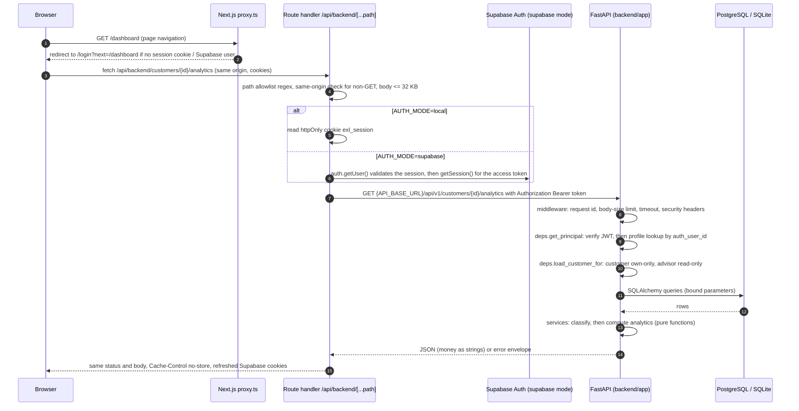

# Architecture

EXL Personalized Financial Advisor is an explainable financial-wellness coach for an Indian retail-banking
context (INR). It runs only on **synthetic data**. This document describes the components, the request flow,
and how the backend code is layered.

## 1. Components

| Component | Technology | Location | Responsibility |
|---|---|---|---|
| Frontend | Next.js 16 (App Router, `cacheComponents: true`), React 19, Tailwind CSS 4, Recharts | `frontend/` | Screens (dashboard, money coach, goals, history, profile, settings), login, and a backend-for-frontend (BFF) proxy |
| BFF proxy | Next.js route handlers | `frontend/src/app/api/backend/[...path]/route.ts`, `frontend/src/app/api/auth/*` | Attaches the access token on the server side, applies a path allowlist, checks same-origin for state-changing calls |
| Navigation gate | Next.js `proxy.ts` (called middleware before Next.js 16) | `frontend/src/proxy.ts` | Sends visitors without a session to `/login?next=...`. This is a convenience redirect, not the security boundary |
| Backend API | FastAPI, Pydantic v2, SQLAlchemy 2, pandas | `backend/app/` | Authentication, authorisation, analytics, recommendation engine, persistence, audit |
| Database | PostgreSQL (Supabase) for deployments; SQLite file for the local demo | `supabase/migrations/`, `backend/data/local.db` | Stored entities, recommendations and their evidence, feedback, audit trail |
| Identity | Supabase Auth (deployments), or local dev-only HS256 tokens | `backend/app/core/security.py` | Issues and verifies access tokens |

### Frontend notes

- The pages under `src/app/(app)/` are client components. They fetch data through `src/lib/api-client.ts`,
  which only calls the same-origin path `/api/backend/...`. The browser never sees the backend URL or the access token.
- With Cache Components on, anything that reads request data has to sit inside a `<Suspense>` boundary. The
  authenticated layout (`src/app/(app)/layout.tsx`) and the login page wrap their request-time content in one.
- Server-only configuration lives in `src/lib/server/config.ts`, which imports `server-only`. That file holds
  `API_BASE_URL` (default `http://localhost:8000`), `AUTH_MODE`, the Supabase URL and publishable key, and a
  15-second upstream timeout. The session cookie is named `exl_session`.
- `next.config.ts` sets the security headers `X-Content-Type-Options`, `X-Frame-Options: DENY`,
  `Referrer-Policy` and `Permissions-Policy`. It also turns off `X-Powered-By` and redirects `/` to `/dashboard`.

## 2. Request flow



What the proxy route handler (`route.ts`) does:

1. **Path allowlist.** The joined path has to match one regular expression that covers `me`, `me/consent`,
   `customers`, `customers/{uuid}` and its sub-resources (`transactions`, `analytics`, `goals`, `goals/{uuid}`,
   `obligations`, `recommendations`, `recommendations/refresh`, `data-quality-events`),
   `recommendations/{uuid}`, `recommendations/{uuid}/feedback` and `recommendation-rules`. Any other path gets
   `404 not_found` and is never forwarded. The local-login and health endpoints cannot be reached through this route.
2. **CSRF check.** Any method other than GET needs an `Origin` header whose host equals `x-forwarded-host` or
   `host` (`isSameOrigin` in `src/lib/server/session.ts`). Otherwise the handler returns `403 forbidden`.
3. **Token.** In local mode the token comes from the httpOnly `exl_session` cookie. In Supabase mode the handler
   first validates the user with `auth.getUser()` and then reads the session's access token. If there is no
   token, it returns `401 unauthenticated`.
4. **Body limit.** Bodies longer than 32,768 characters get `413`. The backend enforces its own 64 KB limit as well.
5. **Forwarding.** The request goes to `{API_BASE_URL}/api/v1/{path}{query}` with `cache: "no-store"` and a
   15-second `AbortSignal.timeout`. A timeout returns `504 timeout`. A network failure returns `503 service_unavailable`.
6. **Response.** The upstream status and body pass through unchanged. Refreshed Supabase cookies are copied onto
   the response.

Login and logout go through `src/app/api/auth/login/route.ts` and `logout/route.ts`, and both are same-origin
checked. In local mode, login calls `POST /api/v1/auth/local/login` and stores the returned token in an httpOnly,
`SameSite=Lax` cookie (marked `Secure` when `NODE_ENV=production`). In Supabase mode the handler calls
`signInWithPassword`, and `@supabase/ssr` manages the session cookies.

## 3. Backend layering (`backend/app`)

```
app/
  main.py              app factory: middleware, CORS, error handlers, routers
  core/                config (pydantic-settings), errors (envelope), logging (JSON + redaction), security (JWT, rate limiter)
  api/
    deps.py            DB session, authentication, authorisation, pagination, rate-limit dependencies
    routes/            thin HTTP handlers: health, auth, customers, transactions, analytics, goals, recommendations, feedback
  schemas/             Pydantic request/response models (api.py, analytics.py)
  services/            business logic
  repositories/        SQLAlchemy queries (customers.py, audit.py)
  models/
    tables.py          ORM tables mirroring the SQL migrations
    domain.py          frozen dataclasses used by the pure services (TxnRecord, AccountRecord, GoalRecord, ...)
  db/                  engine/session (connection.py), SQL migration runner (migrate.py)
  synthetic_data/      generator, validation, seeder, reference data
  utils/               money (Decimal / paise), dates, INR formatting
```

| Layer | Rules |
|---|---|
| `api/routes` | Parse and validate input, call dependencies and services, map results to schemas. No business rules. |
| `api/deps.py` | One central authorisation function, `load_customer_for(principal, session, customer_id, write=...)`. A customer asking for another customer's record gets **404** so the API never confirms the record exists. An advisor attempting a write gets **403**. A valid token with no linked profile gets **403**. `ReadableCustomer` and `WritableCustomer` wrap this function. Also defines pagination (`page` 1–10,000, `page_size` up to 200) and `rate_limit(bucket)`. |
| `services` | Pure, deterministic functions over domain dataclasses: `spending_categorization` (flows and exclusions), `data_quality` (freshness and confidence), `financial_analytics` (`compute_analytics`), `goal_planning`, `recommendation_engine` (rules), `recommendation_explanations` (wording). Only `recommendation_service` touches the database: it handles stable IDs, de-duplication, status changes, feedback and audit. |
| `repositories` | Every query is a SQLAlchemy expression with bound parameters. `load_financial_data` converts ORM rows into a `CustomerFinancialData` domain object, so the services never depend on the ORM. |
| `models/tables.py` | ORM mapping. A `Money` type decorator maps to `NUMERIC(14,2)` on PostgreSQL and to an exact decimal string on SQLite. |
| `models/domain.py` | Immutable inputs to analytics. These are the same objects the synthetic generator produces through `customer_financial_data`, so analytics can run without a database. |
| `schemas` | The public contract. `Decimal` fields serialise as JSON strings. Inputs use `extra="forbid"` and strip whitespace. |

Analytics are **computed on every request** and never stored. Recommendations **are** stored, together with
the evidence used to produce them, so past advice stays explainable after the underlying data changes.

### Cross-cutting middleware (`main.py`)

- **Request ID.** An incoming `X-Request-ID` is accepted if it is 8–64 characters and alphanumeric apart from
  hyphens. Otherwise the server generates one. The ID is returned in a response header and in error bodies.
- **Body size.** If `Content-Length` exceeds `MAX_REQUEST_BODY_BYTES` (default 65,536), the server returns 413.
- **Timeout.** `REQUEST_TIMEOUT_SECONDS` (default 15) is enforced with `asyncio.wait_for` and returns 504.
- **Security headers.** `X-Content-Type-Options: nosniff`, `X-Frame-Options: DENY`, `Referrer-Policy: no-referrer`,
  and `Cache-Control: no-store` on `/api/*`. `Strict-Transport-Security` is added in production.
- **Access log.** One JSON line per request with method, path (no query string), status and duration.
- **CORS.** Only explicit origins, with `allow_credentials=False`. Methods are GET, POST, PATCH and OPTIONS.
- **Docs.** `/docs` and `/redoc` are turned off when `ENVIRONMENT=production`. `/openapi.json` stays available.

## 4. Database modes

| Mode | When | Schema source |
|---|---|---|
| PostgreSQL / Supabase | Deployments, CI `backend-postgres` job, `pytest -m postgres` | `supabase/migrations/*.sql`, applied with `supabase db push` or `python -m app.db.migrate` |
| SQLite (`sqlite:///./data/local.db`) | Zero-dependency local demo, unit/integration tests (in-memory) | `Base.metadata.create_all` from `models/tables.py` |

`tests/integration/test_schema_parity.py` checks that the ORM and the SQL agree on table and column names. The
PostgreSQL engine sets `pool_pre_ping`, a 10-second connect timeout and a 10-second `statement_timeout`. SQLite
connections enable `PRAGMA foreign_keys=ON`. Production configuration rejects SQLite.

## 5. Design decisions

**One modular monolith, not microservices.** The domain is small: one customer aggregate and a single
read-mostly workload. Analytics, rules and persistence share the same data and the same transaction. Splitting
them into services would add network calls, distributed failure modes, more deployments and more secrets to
manage, with no scaling or team-ownership benefit at academic-demo scale. Clear module boundaries (pure services
behind repositories) keep a later split possible.

**No LLMs or opaque models.** Every recommendation comes from a deterministic, versioned rule. Each one records
its inputs, calculations, thresholds, assumptions and a confidence indicator, so the same data, evaluation date
and rule version always give the same advice. This is what makes the advice explainable and auditable, and it
can be tested exactly. Free-form generated text would make it hard to guarantee that the advice never suggests
loans or securities and never invents numbers. Customer-facing wording comes from templates filled with numbers
the engine computed (`recommendation_explanations.py`).

**BFF proxy instead of calling the API from the browser.** Tokens stay in httpOnly cookies, the backend URL is
never exposed, and the API sees only bearer tokens (no cookies). That removes CSRF exposure at the API itself and
lets CORS be strict.

**Exact money.** Money is `NUMERIC(14,2)` in PostgreSQL, `Decimal` in Python, and integer paise inside the pandas
aggregations. JSON carries money as strings. Floats are rejected (`utils/money.py`).
