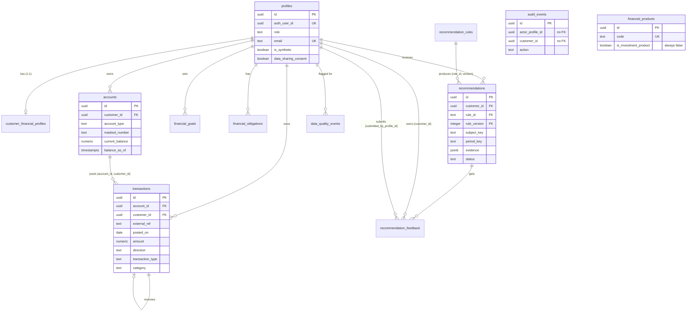

# Database Design

The schema is defined in `supabase/migrations/`, which is the source of truth for PostgreSQL and Supabase:

| File | Purpose |
|---|---|
| `20261024000100_initial_schema.sql` | 12 tables, constraints, indexes, `updated_at` triggers, append-only audit trigger, local-PostgreSQL `auth` shim, `exl_api` role (NOLOGIN) |
| `20261024000200_row_level_security.sql` | RLS on every table, grants, helper functions, policies |
| `20261024000300_reference_data.sql` | Rule catalogue v1 and generic product types. **Generated** from `backend/app/synthetic_data/reference_data.py` |

The migrations are written to be idempotent where practical (`if not exists`, `create or replace`,
drop-then-create for triggers and policies). They run on Supabase and on plain PostgreSQL 15+. When the Supabase
`auth` schema is missing, the first migration creates a minimal `auth.uid()` function plus the `anon` and
`authenticated` roles.

## 1. Conventions

- **Money.** Every monetary column is `NUMERIC(14,2)`, an exact decimal that is never a float. `interest_rate_apr`
  is `NUMERIC(5,2)` and constrained to 0–60.
- **Ownership.** Every customer-owned table carries `customer_id`, which references `profiles(id)` with
  `ON DELETE CASCADE`. Both the API and RLS enforce ownership through this column.
- **Keys.** UUID primary keys default to `gen_random_uuid()` (pgcrypto). Two exceptions: `recommendations.id`
  is supplied by the application as a deterministic UUIDv5, and `recommendation_rules` uses the composite key
  `(rule_id, version)`.
- **Enumerations.** Enumerations are `text` columns with `CHECK (... in (...))` constraints rather than PostgreSQL
  enum types, which keeps migrations simple.
- **Timestamps.** Timestamps are `timestamptz`. A shared trigger, `public.set_updated_at()`, maintains `updated_at`
  on `profiles`, `customer_financial_profiles`, `accounts`, `financial_goals`, `financial_obligations`,
  `financial_products` and `recommendations`.
- **Transaction amounts.** `transactions.amount` is always positive, and `direction` (`credit`/`debit`) gives the sign.

## 2. Entity-relationship diagram



`audit_events` and `financial_products` have no foreign keys to other tables.

## 3. Tables

### 3.1 `profiles`
Each row is a person who can sign in, or a synthetic customer persona.

| Column | Type | Constraints |
|---|---|---|
| id | uuid | PK, default `gen_random_uuid()` |
| auth_user_id | uuid | UNIQUE, nullable. Supabase `auth.users.id`, or a generated id for local demo users |
| role | text | NOT NULL, `customer` or `advisor` |
| display_name | text | NOT NULL, 1–120 chars |
| email | text | UNIQUE, must be lower-case |
| is_synthetic | boolean | NOT NULL, default true |
| data_sharing_consent | boolean | NOT NULL, default true (consent to personalised insights) |
| marketing_consent | boolean | NOT NULL, default false |
| consent_updated_at | timestamptz | |
| created_at, updated_at | timestamptz | NOT NULL, default now() |

### 3.2 `customer_financial_profiles` (1:1 with a customer)

| Column | Type | Constraints |
|---|---|---|
| customer_id | uuid | PK, FK to `profiles(id)` ON DELETE CASCADE |
| persona_segment | text | `young_salaried`, `family_goal_saver`, `pre_retiree`, `gig_worker`, `high_spender`, `debt_stressed`, `new_to_bank`, `stale_profile` |
| income_pattern | text | `salaried_stable`, `irregular`, `pension`, `unknown` |
| declared_monthly_income | numeric(14,2) | null or >= 0 |
| age_band | text | null or `18-24` … `65+` |
| dependents | smallint | null or 0–10 |
| city_tier | text | null or `tier_1`/`tier_2`/`tier_3` |
| risk_preference | text | NOT NULL, default `unknown` (`conservative`, `balanced`, `growth`, `unknown`) |
| currency | char(3) | default `INR` |
| profile_updated_at | timestamptz | NOT NULL. When the customer last confirmed these details |
| created_at, updated_at | timestamptz | |

### 3.3 `accounts`
Reported balances are actual values. Balances estimated from transactions are computed at request time and are
never stored.

| Column | Type | Constraints |
|---|---|---|
| id | uuid | PK |
| customer_id | uuid | NOT NULL, FK to `profiles` ON DELETE CASCADE |
| account_type | text | `savings`, `current`, `credit_card`, `fixed_deposit` |
| nickname | text | 1–60 chars |
| masked_number | text | must match `^XXXX[0-9]{4}$` |
| currency | char(3) | default `INR` |
| opening_balance | numeric(14,2) | NOT NULL |
| opening_balance_date | date | NOT NULL |
| current_balance | numeric(14,2) | nullable (missing balance is allowed) |
| balance_as_of | timestamptz | nullable |
| is_liquid | boolean | NOT NULL. Counts toward emergency-fund coverage |
| status | text | `active` or `closed` |

Constraints: `UNIQUE (id, customer_id)` (target of the composite FK below), `UNIQUE (customer_id, masked_number)`,
and `CHECK ((current_balance is null) = (balance_as_of is null))`. Index: `accounts_customer_idx (customer_id)`.

### 3.4 `transactions`

| Column | Type | Constraints |
|---|---|---|
| id | uuid | PK |
| account_id, customer_id | uuid | NOT NULL. **Composite FK `(account_id, customer_id)` to `accounts(id, customer_id)` ON DELETE CASCADE** |
| external_ref | text | 1–64 chars. `UNIQUE (account_id, external_ref)` blocks re-importing the same bank record |
| posted_on | date | NOT NULL |
| amount | numeric(14,2) | > 0 |
| direction | text | `credit` or `debit` |
| transaction_type | text | `salary`, `business_income`, `pension`, `interest`, `other_income`, `purchase`, `bill_payment`, `loan_payment`, `fee`, `transfer_in`, `transfer_out`, `refund`, `reversal` |
| category | text | 25 values: income categories, essential (`rent` … `loan_emi`), discretionary (`dining` … `gifts`), `bank_fees`, `other_expense`, `transfer`, `uncategorized` |
| merchant_name | text | <= 80 chars |
| description | text | 1–200 chars |
| transfer_group_id | uuid | required if and only if the type is `transfer_in`/`transfer_out` |
| reverses_transaction_id | uuid | FK to `transactions(id)` ON DELETE SET NULL. Required if and only if the type is `reversal` |
| created_at | timestamptz | |

Check constraints:
- `transactions_direction_matches_type`: credit types are income, `transfer_in`, `refund` and `reversal`. Debit
  types are `purchase`, `bill_payment`, `loan_payment`, `fee`, `transfer_out` and `reversal`.
- `transactions_transfer_group` and `transactions_reversal_link`, as described in the table above.

Indexes: `(customer_id, posted_on desc)`, `(account_id, posted_on)`, `(customer_id, category)`, and a partial
index on `transfer_group_id` for rows where it is not null.

**Why a composite FK?** A plain `account_id` FK would allow a transaction labelled with customer A to point at
customer B's account. Referencing `(id, customer_id)` makes the database reject any transaction whose
`customer_id` differs from its account's owner. Both API ownership checks and RLS policies depend on
`transactions.customer_id`, so this guarantee matters.

### 3.5 `financial_goals`

| Column | Type | Constraints |
|---|---|---|
| id | uuid | PK |
| customer_id | uuid | FK to `profiles` ON DELETE CASCADE |
| name | text | 1–80 chars |
| goal_type | text | `emergency_fund`, `home_purchase`, `education`, `retirement`, `vehicle`, `travel`, `wedding`, `debt_payoff`, `other` |
| target_amount | numeric(14,2) | > 0 |
| saved_amount | numeric(14,2) | default 0, >= 0 |
| monthly_contribution | numeric(14,2) | null or >= 0 |
| target_date | date | nullable |
| priority | smallint | 1–5, default 3 (1 = highest) |
| status | text | `active`, `achieved`, `paused`, `cancelled` |

Indexes: `(customer_id, status)`, and the unique partial index `financial_goals_customer_name_active_uidx` on
`(customer_id, lower(name))` where `status <> 'cancelled'`.

### 3.6 `financial_obligations`

| Column | Type | Constraints |
|---|---|---|
| id | uuid | PK |
| customer_id | uuid | FK to `profiles` ON DELETE CASCADE |
| obligation_type | text | `loan_emi`, `rent`, `insurance_premium`, `credit_card_bill`, `school_fees`, `utility`, `subscription`, `tax`, `other` |
| name | text | 1–80 chars |
| amount | numeric(14,2) | > 0 |
| frequency | text | `monthly`, `quarterly`, `half_yearly`, `annual`, `one_time` |
| next_due_date | date | NOT NULL |
| end_date | date | `end_date is null or end_date >= next_due_date` |
| is_essential | boolean | default true |
| outstanding_principal | numeric(14,2) | null or >= 0 |
| interest_rate_apr | numeric(5,2) | null or 0–60 |
| status | text | `active` or `closed` |

Index: the partial index `(customer_id, next_due_date)` where `status = 'active'`.

### 3.7 `financial_products`
This table holds generic, educational product types only. `CHECK (is_investment_product = false)` makes it
impossible to store an investment product.

Columns: `id`, `code` (UNIQUE, `^[A-Z0-9_]{3,40}$`), `name`, `product_type` (`savings_feature`, `deposit`,
`insurance`, `budgeting_tool`, `education`), `description`, `is_investment_product`, `is_active`, timestamps.

### 3.8 `recommendation_rules`
A versioned rule catalogue. Each version is treated as immutable.

Columns: `rule_id` (`^[A-Z0-9_]{3,60}$`), `version` (>= 1), `category` (8 values), `name`, `description`,
`parameters` (jsonb), `is_active`, `created_at`. **PK `(rule_id, version)`**.

### 3.9 `recommendations`
Recommendations are stored together with the evidence used to produce them.

| Column | Type | Notes |
|---|---|---|
| id | uuid | PK, deterministic UUIDv5 (see `recommendation-engine.md`) |
| customer_id | uuid | FK to `profiles` ON DELETE CASCADE |
| rule_id, rule_version | text, integer | **FK to `recommendation_rules(rule_id, version)`** |
| category | text | |
| subject_key | text | 1–120 chars, e.g. `emergency-fund`, `goal:<uuid>` |
| period_key | text | `^[0-9]{4}-[0-9]{2}$` (YYYY-MM of the evaluation date) |
| title, explanation, reason | text | Customer-facing text. Title is 1–160 chars |
| priority | text | `high`, `medium`, `low` |
| priority_reason | text | |
| evidence | jsonb | inputs, calculations, thresholds |
| assumptions, suggested_actions | jsonb | arrays |
| confidence | text | `high`, `medium`, `low` |
| confidence_reason | text | |
| data_as_of | date | latest transaction date used |
| analytics_as_of | date | evaluation date |
| evidence_hash | text | SHA-256 of the canonical payload |
| status | text | `pending`, `accepted`, `dismissed`, `completed`, `expired` |
| status_changed_at | timestamptz | |

Constraints: `recommendations_dedup_unique UNIQUE (customer_id, rule_id, rule_version, subject_key, period_key)`.
Index: `(customer_id, status, created_at desc)`.

### 3.10 `recommendation_feedback`

| Column | Type | Constraints |
|---|---|---|
| id | uuid | PK |
| recommendation_id | uuid | FK to `recommendations` ON DELETE CASCADE |
| customer_id | uuid | FK to `profiles` ON DELETE CASCADE |
| submitted_by_profile_id | uuid | FK to `profiles` (no cascade) |
| action | text | `accepted`, `dismissed`, `completed`, `correction` |
| reason_code | text | null or one of `not_relevant`, `already_doing_this`, `cannot_afford`, `income_incorrect`, `expense_incorrect`, `goal_outdated`, `transaction_miscategorized`, `other` |
| comment | text | <= 500 chars |
| created_at | timestamptz | |

Constraint: `action <> 'correction' or reason_code is not null`. Indexes: `(recommendation_id, created_at desc)`
and `(customer_id)`.

### 3.11 `data_quality_events`
Columns: `id`, `customer_id` (nullable FK to `profiles` ON DELETE CASCADE), `check_code` (1–60 chars),
`severity` (`info`, `warning`, `error`), `entity_type`, `entity_id`, `details` (jsonb), `detected_at`,
`resolved_at`. Index: `(customer_id, detected_at desc)`. The seeder writes one row for each data-quality issue it
finds per customer (`persist_quality_events` in `seed.py`).

### 3.12 `audit_events` (append-only)
Columns: `id`, `actor_profile_id`, `customer_id`, `action` (1–80 chars), `entity_type`, `entity_id`,
`request_id`, `metadata` (jsonb), `created_at`. Index: `(customer_id, created_at desc)`.

- **Append-only.** The trigger `audit_events_append_only` runs `prevent_audit_mutation()` before UPDATE or
  DELETE and raises `audit_events is append-only`. In addition, `exl_api` is granted only SELECT and INSERT on
  this table.
- **No foreign keys.** The audit trail has to outlive the rows it describes. A cascading FK would delete history
  when a profile is removed. A `SET NULL` FK would rewrite history, and the trigger blocks updates anyway. Storing
  plain IDs keeps every row immutable.
- **What gets logged.** Actions include `auth.local_login`, `consent.updated`, `goal.created`, `goal.updated`,
  `recommendations.refreshed`, and `recommendation.feedback.<action>`. Metadata never contains tokens, transaction
  descriptions, or feedback comments.

## 4. Row-level security (`20261024000200_row_level_security.sql`)

The backend already authorises every request. RLS is a second layer of defence: someone holding the public anon
key, or a stolen customer token, still cannot read another customer's rows through PostgREST.

| Item | Behaviour |
|---|---|
| RLS | `ENABLE` and `FORCE ROW LEVEL SECURITY` on all 12 tables. All privileges are revoked from `anon` and `authenticated` first |
| Helpers | `current_profile_id()` and `current_user_is_advisor()`. Both are `SECURITY DEFINER` with a fixed `search_path`, so they resolve the caller through `profiles.auth_user_id = auth.uid()` without recursive RLS. Execute is granted only to `authenticated` and `exl_api` |
| `authenticated` | SELECT only, on profiles, financial profiles, accounts, transactions, goals, obligations, products, rules, recommendations and feedback. Customer-owned tables use the policy `customer_id = current_profile_id() or current_user_is_advisor()`. `profiles` uses `auth_user_id = auth.uid() or advisor`. Products are readable when `is_active`. Rules are readable by everyone in this role. No access to `data_quality_events` or `audit_events`. No writes |
| `anon` | Nothing |
| `exl_api` (backend) | SELECT, INSERT, UPDATE on entity tables and `data_quality_events`. SELECT and INSERT only on `recommendation_feedback` and `audit_events`. **No DELETE anywhere.** A policy `<table>_backend_all` with `using (true)` exists for this role |

The first migration creates `exl_api` as `NOLOGIN`. A login password is set manually for each environment (see
`security.md` and `deployment.md`). It is never stored in Git.

## 5. Reference data

`20261024000300_reference_data.sql` inserts the eight v1 rules into `recommendation_rules`
(`on conflict do nothing`) and four generic products into `financial_products`: `SWEEP_SAVINGS`,
`RECURRING_DEPOSIT`, `BUDGET_ALERTS` and `TERM_INSURANCE_EDU` (`on conflict (code) do update`). The file is
generated, not hand-edited:

```bash
cd backend && python -m app.synthetic_data.reference_data > ../supabase/migrations/20261024000300_reference_data.sql
```

`tests/unit/test_synthetic_data.py::test_reference_data_migration_matches_code` fails if the committed SQL drifts
from `RULES` in `recommendation_engine.py`. At runtime, `recommendation_service.ensure_rules()` also inserts any
missing rule versions so the recommendations FK always resolves.

## 6. Stored vs computed

| Data | Stored? | Where / how |
|---|---|---|
| Profiles, financial profiles, accounts, transactions, goals, obligations, products | Stored | Tables above |
| Reported account balance | Stored | `accounts.current_balance` + `balance_as_of` |
| Balance estimated from transactions, reconciliation difference | Computed | `financial_analytics._account_balances` |
| Transaction classification (income / expense / refund / excluded + reason, effective category) | Computed | `spending_categorization.classify_transactions` (per request, on full history) |
| Totals, monthly averages, savings rate, category spend, monthly trend, month-over-month | Computed | `financial_analytics.compute_analytics` |
| Recurring expenses, income stability (coefficient of variation) | Computed | `compute_analytics` |
| Emergency-fund coverage, savings capacity, upcoming obligations (30 days) | Computed | `compute_analytics` |
| Goal progress and plans | Computed | `goal_planning.plan_goal` via `plan_all_goals` |
| Data quality, freshness, confidence | Computed. A snapshot is stored at seed time in `data_quality_events` | `data_quality.assess_data_quality` |
| Recommendations with evidence, status, feedback | Stored | `recommendations`, `recommendation_feedback` |
| Rule catalogue | Stored (code is canonical) | `recommendation_rules` |
| Audit trail | Stored, append-only | `audit_events` |

Analytics are computed rather than stored because they depend on the evaluation date and can always be
recomputed exactly. Storing them would create cache-invalidation problems. Recommendations are stored because
customers act on them and the advice has to remain explainable as it was given.

## 7. SQLite local mode and schema parity

When `DATABASE_URL` is SQLite (the local default), the seeder calls `Base.metadata.create_all` to build the
schema from `backend/app/models/tables.py`. The ORM mirrors the SQL tables, columns, key constraints and checks,
using these mappings:

- `Money` is stored as an exact decimal string on SQLite and as `NUMERIC(14,2)` on PostgreSQL.
- JSON becomes `JSONB` on PostgreSQL.
- `PRAGMA foreign_keys=ON` is set on every SQLite connection.
- Money CHECK constraints in the ORM cast to a number (`CAST(amount AS NUMERIC) > 0`, goal target `> 0`, goal
  saved `>= 0`). Without the cast, SQLite compares the stored decimal *text* with a number and always passes, so
  a zero or negative amount would be accepted locally. `tests/unit/test_synthetic_data_quality.py::test_database_constraints`
  covers this together with the duplicate-import UNIQUE, the composite owner FK and the direction check.

The ORM carries only a subset of the SQL CHECK constraints (role, balance pair, money signs, direction). The
full set — category and type lists, direction/type pairing, transfer group, reversal link, masked-number format,
status lists, "no investment products" — exists only in the PostgreSQL migrations and is tested by
`tests/integration/test_postgres.py`.

What SQLite mode does **not** have: RLS, the `updated_at` and append-only triggers, and the PostgreSQL-specific
partial or expression indexes. Run the PostgreSQL tests (`pytest -m postgres`) to cover those.

`backend/tests/integration/test_schema_parity.py` parses `20261024000100_initial_schema.sql` without a database
and asserts that:
- the set of tables in the SQL equals `ALL_TABLES` and `Base.metadata.tables` (`test_tables_match`), and
- each table's column names match exactly (`test_columns_match`).

The parity test checks names only. Types, constraints and indexes are exercised by the PostgreSQL integration
tests in `test_postgres.py`: `test_migrations_re_runnable`, `test_constraints_enforced`,
`test_audit_events_are_append_only`, `test_row_level_security_isolates_customers`, `test_money_is_exact_numeric`
and `test_api_against_postgres`.

## 8. Migrations workflow

- Apply with `supabase db push`, or with `DATABASE_URL=postgresql://... python -m app.db.migrate`. The second
  runs each file once inside a transaction and records it in `public.schema_migrations`.
- Migrations only move forward. To roll back, write explicit down SQL and test it on a copy first (see
  `deployment.md`).
- Run migrations and seeding as the database owner (for example the Supabase `postgres` role), not as `exl_api`.
  `exl_api` cannot create objects and has no DELETE privilege.
