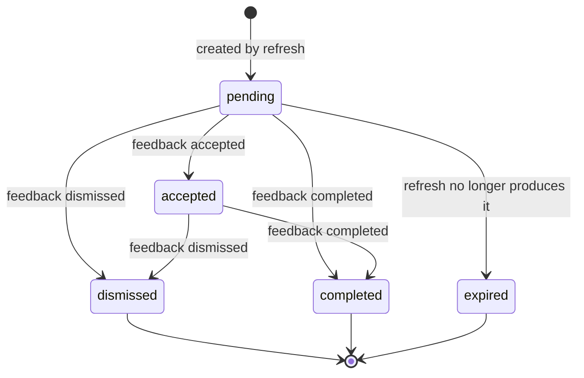

# Recommendation Engine

The money coach produces advice from **deterministic, versioned rules** over analytics computed from synthetic
data. No machine-learning model or LLM is involved. Given the same data, evaluation date (`as_of`) and rule
versions, the engine always produces the same recommendations with the same evidence.

## 1. Separation of concerns

| Module | Responsibility |
|---|---|
| `services/financial_analytics.py` (with `spending_categorization.py`, `data_quality.py`, `goal_planning.py`) | Turns stored data into metrics (`AnalyticsResult`). Pure functions. |
| `services/recommendation_engine.py` | Decides **which** recommendations apply and **why**. Each one becomes a `RuleOutcome` with facts, evidence, priority and priority reason, assumptions and actions. Rules whose inputs are unavailable are recorded as a `SuppressedRule` with a reason. Pure, no I/O. |
| `services/recommendation_explanations.py` | Turns facts into customer-facing `title`, `explanation` and `reason` from templates. It never computes or invents numbers. Wording can change without touching the decision logic, and the reverse is also true. |
| `services/recommendation_service.py` | Persistence: stable IDs, de-duplication, updates, expiry, status transitions, feedback and audit events. |

```
CustomerFinancialData --compute_analytics--> AnalyticsResult --evaluate--> EngineResult(outcomes, suppressed)
     --explain--> text --recommendation_service.refresh_for_customer--> recommendations table
```

## 2. Gating (in `evaluate`)

Rules run in this fixed order: MISSING_INFO_REQUEST, EMERGENCY_FUND_BUILD, GOAL_SAVINGS_INCREASE,
DISCRETIONARY_SPENDING_REVIEW, UPCOMING_OBLIGATIONS_PREPARE, RECURRING_EXPENSES_REVIEW, CASH_FLOW_CONSISTENCY,
GOAL_PROGRESS_CELEBRATE.

1. **Consent withdrawn.** If `profiles.data_sharing_consent = false`, no rule runs. All eight are suppressed with
   the reason "Customer has not consented to personalised insights." Pending recommendations are expired as
   soon as consent is withdrawn (`PATCH /api/v1/me/consent`).
2. **Low data confidence.** If `data_quality.confidence = "low"`, every rule except **MISSING_INFO_REQUEST** and
   **GOAL_PROGRESS_CELEBRATE** is suppressed with the reason "Paused because data confidence is low: <reasons>".
   Those two run because they rely only on data-quality facts and recorded goal amounts.
3. **Per-rule suppression.** Some rules return `SuppressedRule` when an input they need is missing (see each rule).
   The refresh response returns these suppressions as `suppressed_rules`. Missing data is never treated as zero.

Outcomes are sorted by priority (high, then medium, then low), then `rule_id`, then `subject_key`.
`period_key` is the `YYYY-MM` of `as_of`. `data_as_of` is the latest transaction date.

## 3. The eight rules (all version 1)

Rule parameters are stored in `RULES` and mirrored in `recommendation_rules.parameters`. Every outcome's
`evidence` has the shape `{ "inputs": {...}, "calculations": {...}, "thresholds": <rule parameters> }`. Money
values inside evidence are strings.

Most rules add a qualifier to their assumptions when confidence is below high (`_confidence_qualifier`):
"Data confidence is medium: ...". MISSING_INFO_REQUEST and GOAL_PROGRESS_CELEBRATE do not.

### 3.1 MISSING_INFO_REQUEST (`missing_information`)
- **Parameters:** `stale_after_days: 35`, `min_history_months: 3`.
- **Gaps collected:**
  - `recent_transactions`, when freshness is `stale` (more than 35 days since the last transaction) or `no_data`
  - `longer_transaction_history`, when the issue `short_history` is present (fewer than 3 complete months with counted data)
  - `monthly_income`, when the issue `missing_income` is present (no declared income **and** no income transactions)
  - `account_balances`, when the issue `missing_balance` is present (an active liquid account has no reported balance)
- **Trigger:** at least one of the gaps above. If the rule triggers and the profile is stale (more than 365 days),
  `profile_confirmation` is added as a further gap. A stale profile on its own does not trigger the rule.
- **Subject:** `data-gaps`.
- **Priority:** `high` if confidence is low ("other guidance is paused until this is resolved"), otherwise `medium`.
- **Evidence:** inputs are `freshness`, `days_since_last_transaction`, `latest_transaction_date`,
  `history_months`, `balance_status`, `quality_issue_codes`. Calculations are `missing_items`.
- **Actions:** one action per gap, for example "Confirm your typical monthly income in your profile."

### 3.2 EMERGENCY_FUND_BUILD (`emergency_fund`)
- **Parameters:** `base_target_months: 3`, `elevated_target_months: 6`, `high_priority_below_months: 1`,
  `max_share_of_capacity: "0.50"`, `build_months: 12`.
- **Suppressed** when the emergency-fund status is `unknown`. That happens when the liquid balance is not
  reported, or when there are fewer than 3 months with data, or when average essential spend is missing or <= 0.
- **No outcome** when the status is `sufficient` (coverage >= target).
- **Trigger:** status `insufficient` (coverage < 1) or `building` (1 <= coverage < target).
- **Suggested monthly amount:** `emergency_reserve(capacity) = min(round(0.50 × capacity), round(gap / 12))`. It is
  0 when capacity is unknown. When it is 0, no amount is suggested and the action says to review non-essential
  spending instead. `months_to_target = ceil(gap / suggested)`.
- **Subject:** `emergency-fund`.
- **Priority:** `high` if coverage < 1 month. `low` if coverage >= 90% of the target. Otherwise `medium`.
- **Evidence:** inputs are `liquid_balance`, `average_monthly_essential_expenses`, `target_months`,
  `estimated_monthly_capacity`, `basis_months`. Calculations are `coverage_months`, `target_amount`, `gap_amount`,
  `suggested_monthly`, and `months_to_target` (when an amount is suggested).

### 3.3 GOAL_SAVINGS_INCREASE (`goal_savings`)
- **Parameters:** `high_priority_goal_rank: 1`, `high_priority_within_months: 12`.
- **Trigger:** applies to each goal whose plan has `plan_status = "behind"` and a known `required_monthly`. The
  goal must be dated, active, not achieved, and planned contribution < required.
- **Subject:** `goal:<goal_id>`, one outcome per goal.
- **Priority:**
  - `high` if goal priority = 1 and `months_remaining <= 12`
  - `low` if goal priority >= 4
  - otherwise `medium`
- **Actions:**
  - If capacity covers the shortfall: "Increase the monthly contribution by about Rs X".
  - If capacity is short: add the most the estimate allows and consider moving the target date to the suggested
    month.
  - If no amount or date can be suggested: "Review the target amount or date".
- **Evidence:** inputs are `goal_id`, `target_amount`, `saved_amount`, `planned_monthly`, `target_date`,
  `goal_priority`, `estimated_monthly_capacity`. Calculations are the goal plan's `calculation` dictionary.

### 3.4 DISCRETIONARY_SPENDING_REVIEW (`discretionary_spending`)
- **Parameters:** `share_threshold_pct: "35"`, `spike_ratio: "1.25"`, `spike_min_increase: "2000"`,
  `illustrative_reduction_pct: "10"`.
- **Suppressed** when `basis_months < 3`, or when average expenses are missing or zero, or when the average
  discretionary figure is missing. The reason given is "Needs at least 3 months of expense data."
- **share** = average monthly discretionary ÷ average monthly expenses × 100, rounded to 0.1.
- **spike:** the latest complete month that has data is compared with the average of the 3 complete months before
  it (exactly 3 are required). A spike needs `latest >= 1.25 × trailing average` **and**
  `latest − trailing average >= Rs 2,000`.
- **Trigger:** `share >= 35%`, or a spike.
- **Subject:** `discretionary`.
- **Priority:** `high` if average net observed cash flow < 0, otherwise `medium`.
- **Evidence:** average discretionary, average expenses, basis months, and the top 3 discretionary categories.
  Calculations are `discretionary_share_pct`, `illustrative_monthly_saving` (10% of average discretionary,
  explicitly "not a target"), and `latest_vs_trailing`.

### 3.5 UPCOMING_OBLIGATIONS_PREPARE (`upcoming_obligations`)
- **Parameters:** `horizon_days: 30`, `balance_share_threshold: "0.50"`.
- **Inputs:** active obligations whose next occurrence falls in `[as_of, as_of + 30 days]`. Recurring due dates
  are rolled forward by their frequency, and occurrences after `end_date` are dropped.
- **Lumpy items:** obligations whose frequency is not `monthly`. `share = total_due ÷ reported liquid balance`
  (2 decimal places) when the liquid balance is > 0.
- **Trigger:** at least one item, **and** either some item is lumpy or `share > 0.50`.
- **Subject:** `upcoming-30d`.
- **Priority:**
  - `high` if the liquid balance is known and `total_due > liquid balance`
  - `medium` if `share > 0.50`, or a lumpy item is due within 14 days
  - otherwise `low`
- If the liquid balance is unknown, an assumption records that affordability could not be checked.
- **Actions:** "Keep Rs X available for <name> by <date>", for up to 3 lumpy items (or up to 3 items if none are lumpy).

### 3.6 RECURRING_EXPENSES_REVIEW (`recurring_expenses`)
- **Parameters:** `min_subscriptions: 3`, `min_monthly_total: "1500"`, `income_share_threshold_pct: "3"`.
- **Inputs:** recurring expenses whose detected category is `subscriptions`. Detection is described in section 9.
- **Trigger:** 3 or more subscriptions, **or** at least one subscription where the monthly total is >= Rs 1,500 or
  >= 3% of average monthly income.
- **Subject:** `subscriptions`.
- **Priority:** `medium` if average net cash flow < 0, otherwise `low`.
- **Evidence:** per-merchant average amount, months observed and last date. Calculations are the monthly total,
  the annual total (× 12), and the share of income.

### 3.7 CASH_FLOW_CONSISTENCY (`cash_flow_consistency`)
- **Parameters:** `lookback_months: 3`, `negative_months_threshold: 2`, `income_cv_threshold: "0.25"`.
- **Suppressed** when there are fewer than 3 complete months with data, with the reason "Needs 3 complete months
  of data."
- **Trigger:** 2 or more of the last 3 complete months have net observed cash flow < 0, **or** the income
  coefficient of variation is > 0.25.
- **Subject:** `cash-flow`.
- **Priority:** `high` if average net cash flow over the period is < 0, otherwise `medium`.
- **Actions:** keep a buffer of about one month of essential expenses. For variable income, set part of large
  payments aside. Schedule bills shortly after income arrives.

### 3.8 GOAL_PROGRESS_CELEBRATE (`goal_celebration`)
- **Parameters:** `milestones_pct: [50, 75, 100]`.
- **Trigger:** each goal that is not `paused` or `cancelled` with `progress_pct >= 50`. The milestone is the
  highest of 50, 75 or 100 reached.
- **Subject:** `goal:<goal_id>:m<milestone>`, so each new milestone is a new recommendation.
- **Priority:** always `low` ("no action is required"). Runs even when confidence is low.

## 4. Stable IDs, de-duplication and updates (`recommendation_service.py`)

- **ID:** `uuid5(RECOMMENDATION_NAMESPACE, f"{customer_id}|{rule_id}|{rule_version}|{subject_key}|{period_key}")`
  with `period_key = YYYY-MM`. The same advice in the same month always maps to the same row. The database
  enforces the same identity with
  `UNIQUE (customer_id, rule_id, rule_version, subject_key, period_key)`.
- **evidence_hash:** SHA-256 of the canonical JSON of title, explanation, reason, priority, priority reason,
  evidence, assumptions, suggested actions, confidence and confidence reason.
- **Refresh outcomes:**

  | Situation | Result |
  |---|---|
  | New ID | Inserted as `pending` (`created`) |
  | Existing row, `pending`, hash differs | Content, hash, `data_as_of` and `analytics_as_of` are updated (`updated`) |
  | Existing row, any other case | Left untouched (`unchanged`). Accepted, dismissed and completed decisions are never overwritten |

- **Not re-raising decided subjects:** before inserting a **new** ID (for example, in a new month), the service
  checks whether the customer has already acted on the same `(rule_id, subject_key)`. A subject counts as decided
  if it was **accepted** at any time, or **dismissed less than 60 days ago** (`DISMISSAL_RESPECT_DAYS = 60`). If
  so, the outcome is skipped and counted as `unchanged`. Completed and expired subjects can be raised again in a
  later period.
- **Expiry:** after evaluation, every `pending` recommendation for the customer whose ID was not produced by this
  run becomes `expired` (with `status_changed_at` set). This covers conditions that no longer hold, withdrawn
  consent, rules paused by low confidence, and the previous month's pending items after the month rolls over.
- **First GET:** `GET /customers/{id}/recommendations` runs a refresh only when the customer has no
  recommendations at all. Stable IDs make this idempotent.
- **Audit:** each refresh writes `recommendations.refreshed`. The metadata holds the created, updated and expired
  counts, `as_of`, and the rule versions.

## 5. Status transitions and feedback



Any other transition returns `409`. `correction` feedback (which requires a `reason_code` such as
`income_incorrect` or `transaction_miscategorized`) is stored without changing the status. Feedback comments are
stored but never copied into the audit log.

## 6. Capacity allocation (no double counting)

All suggested amounts come from one conservative pool:

1. `estimated_monthly_capacity` is computed as in section 9.4.
2. **Suggestion pool** = 50% of capacity (`MAX_SHARE_OF_CAPACITY_FOR_SUGGESTIONS = 0.50`).
3. **Emergency fund first:** `emergency_reserve = min(pool, gap / 12)` when the emergency-fund status is
   `insufficient` or `building` and the gap is > 0. Otherwise it is 0.
4. **Goals next:** `goal_allocatable_capacity = max(pool − emergency_reserve, 0)`. `plan_all_goals` plans the
   non-cancelled goals ordered by (`priority`, `target_date`, `name`). Each goal's `suggested_increase` is
   subtracted from what remains before the next goal is planned.
5. If capacity is unknown (low confidence, or fewer than 3 months with data), every amount is `null` and the
   guidance says that an amount cannot be estimated safely.

## 7. Safety guarantees

- **No loans.** No rule suggests borrowing. The emergency-fund text says the cushion exists so the customer can
  handle surprises *without* borrowing. Tests scan the generated text for every synthetic customer for phrases
  like "take a loan", "borrow more" and "personal loan offer".
- **No securities or specific investment products.** Recommendations never name products. `financial_products`
  holds only generic educational types, and `CHECK (is_investment_product = false)` enforces that. Tests also scan
  for "stock", "mutual fund", "crypto" and "guaranteed return".
- **No transactions.** The API has no endpoint that moves money. Suggestions are text such as "Set up a monthly
  transfer of about Rs X".
- **Missing never becomes zero.** Averages use only months that have data. Unknown balances make the emergency
  fund `unknown`, and the rule is then suppressed with a reason. Unknown capacity means no amount is suggested.
  `format_inr(None)` renders "not available". A test asserts that "None" never appears in generated text.
- **Bounded amounts.** Suggested monthly amounts never exceed the estimated capacity. Tests check this for every
  synthetic customer.

## 8. Worked example

Data: synthetic `customer01@demo.exl.test` (persona `young_salaried`, `salaried_stable`, 0 dependents). Seed 42,
`as_of = 2026-10-24`. The analysis period is the 6 complete months from 2026-04-01 to 2026-09-30, all with data.
These are the actual engine outputs for that input.

**Analytics**

| Metric | Value |
|---|---|
| Average monthly income | 78,459.34 |
| Average monthly expenses | 52,200.72 (essential 39,988.04, discretionary 12,212.68) |
| Average net observed cash flow | 26,258.62. The last-3-month average is 26,544.40, which is not lower, so the period average is the basis |
| Provision for non-monthly obligations | Life Insurance Premium (annual) ÷ 12 = 2,583.33 |
| Estimated monthly capacity | max(26,258.62 − 2,583.33, 0) = **23,675.29** |
| Reported liquid balance | 116,439.36 |
| Emergency fund target | 3 months (standard): 39,988.04 × 3 = 119,964.12 |
| Coverage | 116,439.36 ÷ 39,988.04 = **2.9 months**, status `building` |
| Gap | max(119,964.12 − 116,439.36, 0) = 3,524.76 |

**EMERGENCY_FUND_BUILD**

| Step | Value |
|---|---|
| Suggestion pool | 50% × 23,675.29 = 11,837.65 |
| Suggested monthly | min(11,837.65, 3,524.76 ÷ 12) = **293.73** |
| Months to target | ceil(3,524.76 ÷ 293.73) = 12 |
| Priority | `low`, because 2.9 >= 0.9 × 3 ("Coverage of 2.9 months is close to the 3-month target.") |

Text produced by the explanation layer:
> **Build your emergency fund.** Your liquid savings cover about 2.9 months of essential expenses. A 3-month
> cushion helps you handle surprises without borrowing. Setting aside about Rs 293.73 a month would close the gap
> in roughly 12 months.

The stored `evidence.calculations` reproduce every step, for example
`"suggested_monthly": "min(50% of capacity 23675.29, gap 3524.76 / 12) = 293.73"`.

**Goals.** The amount left for goals is 11,837.65 − 293.73 = 11,543.92. This customer's two goals are both
`behind`. The suggested increases are 468.14 (Emergency Fund, priority 1) and 113.85 (Goa Trip). Both fit within
the remaining pool, so each produces a GOAL_SAVINGS_INCREASE outcome.

Across all 60 synthetic customers on this seed and date, the outcome counts are:

| Rule | Outcomes |
|---|---|
| GOAL_SAVINGS_INCREASE | 50 |
| GOAL_PROGRESS_CELEBRATE | 44 |
| EMERGENCY_FUND_BUILD | 30 |
| UPCOMING_OBLIGATIONS_PREPARE | 25 |
| RECURRING_EXPENSES_REVIEW | 22 |
| MISSING_INFO_REQUEST | 12 |
| DISCRETIONARY_SPENDING_REVIEW | 8 |
| CASH_FLOW_CONSISTENCY | 7 |

48 customers have high confidence and 12 have low confidence (the 7 `stale_profile` and 5 `new_to_bank` customers).

## 9. Metric formulas

### 9.1 Transaction classification (`spending_categorization.py`)
Transactions are processed in a stable order: `(posted_on, external_ref, id)`.

1. **Probable duplicate:** same account, date, amount, direction and upper-cased, trimmed description as an
   earlier row. The later row is `excluded / probable_duplicate`.
2. **Reversal pairs:** a `reversal` whose `reverses_transaction_id` points to a non-duplicate transaction
   excludes both rows (`reversal` and `reversed`). Without that link, the reversal is `orphan_reversal`.
3. **Transfers:** legs are grouped by `transfer_group_id`. A group is matched if it has a debit leg and a credit
   leg and the signed amounts sum to 0. Matched legs are `internal_transfer`; anything else is
   `unmatched_transfer`. Both are excluded. A matched credit into a `fixed_deposit` account is marked
   `is_savings_transfer`.
4. Remaining rows are classified by type: income types count as `income`, `refund` as `refund` (a negative
   expense), and purchase, bill, loan and fee types as `expense`.
5. **Category:** the provided category is used unless it is `uncategorized`. In that case ordered keyword rules
   run over the merchant and description (for example `BIGBASKET` maps to groceries). If nothing matches, the
   category stays `uncategorized`.
6. **Groups:**
   - Essential: rent, utilities, groceries, transport, insurance, healthcare, education, childcare, loan_emi
   - Discretionary: dining, shopping, entertainment, subscriptions, travel, personal_care, gifts
   - Other: bank_fees, other_expense, uncategorized

### 9.2 Period, totals and averages (`financial_analytics.py`)
Aggregation runs in pandas on **integer paise** and is converted back to `Decimal` rupees. Transactions dated
after `as_of` are ignored and flagged.

- **Default period:** the last `months` (default 6) *complete* calendar months before the month containing `as_of`.
- **total_income** = sum of income rows. **total_expenses** = expenses − refunds. **net_observed_cash_flow** =
  income − expenses.
- **excluded_internal_transfers** counts each matched transfer once (its debit leg).
- **Monthly averages** = period total ÷ `months_with_data`, where a month has data only if it contains counted
  transactions. Months without data are not averaged in as zero. If no month has data, the averages are `null`.
- **savings_rate:**
  - `(income − expenses) ÷ income × 100`, rounded half-up to 0.1, when `months_with_data >= 3` and income > 0
  - otherwise status `insufficient_data` or `no_income` with value `null`
- **Category spend:** expenses net of refunds per category. Only categories with a net amount > 0 are listed.
  Share = amount ÷ total expenses.
- **Trend:** one point per month from period start to `as_of`. The current month is marked `is_partial` and is
  excluded from month-over-month comparisons.
- **Income stability:** coefficient of variation = population standard deviation ÷ mean of monthly income, over
  months with income > 0. At least 3 such months are needed. The pattern is `variable` if CV > 0.25, otherwise
  `stable`.

### 9.3 Balances and emergency fund
- **Liquid balance:** the sum of `current_balance` across active accounts with `is_liquid` (savings in the
  synthetic data). If any liquid account lacks a balance, the status is `missing` and the value `null`. The status
  is `stale` if any balance is older than 7 days.
- **Estimated balance** = opening balance + signed non-duplicate transactions from `opening_balance_date` to
  `as_of`. The **reconciliation difference** is shown only when the reported balance is at least as recent as the
  latest transaction. A non-zero difference adds the warning `balance_mismatch`.
- **Emergency target:** 6 months if `income_pattern = irregular` or `dependents >= 2`, otherwise 3 months.
- **coverage** = liquid ÷ average essential expenses (half-up to 0.1). **target_amount** = average essential ×
  target months. **gap** = max(target − liquid, 0).
- **Status:** `sufficient` if coverage >= target, `building` if coverage >= 1, otherwise `insufficient`. It is
  `unknown` when the balance is missing, or there are fewer than 3 months with data, or average essential spend is <= 0.

### 9.4 Savings capacity
- `null` if confidence is low, or if there are fewer than 3 months with data.
- **basis** = the lower of the period-average net cash flow and the average of the last 3 period months. The
  3-month figure is used only when all 3 months have data.
- **provision** for active obligations that have a next occurrence:
  - quarterly, half-yearly and annual: amount ÷ frequency in months
  - one-time due within 6 months: amount ÷ max(days until due // 30, 1)
  - monthly: none, because these are already part of observed expenses
- **estimated_monthly_capacity** = max(basis − provision, 0).
- **observed_monthly_transfers_to_savings** = matched transfers into fixed deposits ÷ months with data. This is
  informational only.

### 9.5 Recurring expenses
An expense series counts as recurring when all of the following hold:
- the expenses fall within the last 6 months, `(as_of − 6 months, as_of]`
- they are grouped by normalised merchant (upper-case letters only)
- they appear in 3 or more distinct months
- (max − min) ÷ median amount <= 15%
- the median gap between charges is 25–35 days
- the last charge was within 45 days of `as_of`

A series is a subscription when its most common category is `subscriptions`.

### 9.6 Data quality and confidence (`data_quality.py`)

| Check | Threshold |
|---|---|
| Freshness | days since the latest transaction: <= 10 `fresh`, <= 35 `aging`, > 35 `stale`, none `no_data` |
| Balance stale | `balance_as_of` older than 7 days |
| Profile stale | `profile_updated_at` older than 365 days (issue `stale_profile`) |
| History | complete calendar months with counted data (the current month is excluded). Fewer than 3 gives `short_history`. **3 is the minimum, 6 counts as full** |
| Uncategorised share | more than 10% of expenses gives the warning `high_uncategorized_share`. Any uncategorised expense gives the info issue `uncategorized_transactions` |
| Missing income | no declared income and no income transactions (severity error) |
| Other issues | `future_dated_transaction`, `probable_duplicate`, `orphan_reversal`, `unmatched_transfer`, `no_transactions`, `stale_transactions`, `missing_balance`, `stale_balance`, `missing_profile` |

Confidence is determined as follows:
- **low** if transactions are stale or missing, history is under 3 months, or income cannot be determined.
- **medium** if transactions are aging, history is 3–5 months, the balance is stale or missing, more than 10% of
  expenses are uncategorised, or the profile is stale.
- **high** otherwise.

The reasons are listed in `confidence_reasons`.

### 9.7 Goal planning (`goal_planning.py`)
- remaining = max(target − saved, 0). progress = saved ÷ target × 100, capped at 100.
- `paused` or `cancelled` goals get `inactive` and no guidance. remaining = 0 or status `achieved` gives `achieved`.
- No target date gives `no_target_date`. The projected completion is `as_of + ceil(remaining ÷ planned)` months
  when a contribution is planned.
- `months_remaining` = whole calendar months from `as_of` to the target date. A value <= 0 gives `overdue`.
- `required_monthly` = ceil to the paisa of remaining ÷ months_remaining. If the planned contribution covers it,
  the status is `on_track`.
- Otherwise the status is `behind`:
  - **Capacity unknown:** no amount is suggested.
  - **Capacity >= shortfall:** `suggested_increase` = shortfall.
  - **Capacity < shortfall:** `suggested_increase` = the available capacity (when > 0), and
    `suggested_target_date` = `as_of + ceil(remaining ÷ (planned + capacity))` months.
